# W45N8 anti-NPC defender — threat state machine (2026-10-13 rev 2). Flag `defend: true`, **armed only by code gate** `threat.armed()`

Gate (code, `src/managers/threat.js armed()`, unit-tested): flag AND RCL≥4 with cap≥1300 held ≥1500 ticks AND room full within the last 300 ticks AND a reserver with ≥2 CLAIM seen within 1500 ticks. Flag off = `defend:false` in CFG (or patrol leaves it); the gate cannot be bypassed by the flag alone.
§3 below is superseded by §6 for decisions (the role's kite/heal mechanics are unchanged).

## 1. Invader mechanics (read from the engine/back-end source, screeps/engine + screeps/backend-local)
| Item | Fact |
|---|---|
| Trigger | Every harvest adds to `source.invaderHarvested`. When the **room total** ≥ `room.invaderGoal`, a raid spawns (checked by a cron for rooms with no Invader inside). Goal = 100 000 × U(0.7, 1.3) ⇒ **70k–130k**; 10% of the time ×2 or ×0 (×0 = next raid immediately). Counter resets to 0 after each raid. We record `Memory.remote.W45N8.invaderHarvested`. |
| Precondition | There must be a live invader core (level>0) in the sector — true here (we already had one raid). |
| Where | One random exit **side**, random tile on it. Sides whose neighbour room is owned or reserved are excluded ⇒ never from W46N8 (left). W45N8 has no top exit ⇒ **bottom (x4–38, y49) or right (x49, y26–32)**, both ≥ 30 tiles from our source (14,12) / container (13,11). |
| Size | Unowned controller ⇒ always **small** bodies. 90% single creep; 10% 2+ (then 20%×: up to 5). First creep is always Melee; others Ranged or Healer (≈50/50). |
| Bodies | smallMelee: 2 TOUGH, 5 MOVE, 1 RANGED_ATTACK, 1 WORK, 1 ATTACK (1000 hp; 30 melee + 10 ranged/t; WORK dismantles 50/t). smallRanged: 2 TOUGH, 5 MOVE, 3 RA (30/t at ≤3, flees to range 3 — kites). smallHealer: 5 MOVE, 5 HEAL (60 hp/t adjacent). |
| Boosts | **50%** chance for small raids: TOUGH GO (takes 70%), ATTACK UH ×2, RA KO ×2, HEAL LO ×2, WORK ZH. Boosted melee = 60 + 20 /t adjacent. |
| Life | 1500 ticks; they never leave the room (pathing maxRooms 1); in an **unowned** room they do not suicide, they hunt our creeps then hit structures. |
| Today | One smallMelee 13:40–14:40 (≈ tick 83613200+); our container (13,11) was **destroyed** during the pause (needs 5 000 energy to rebuild). |
| Invader cores | Level-0 cores (100k hits, no creeps) in a reserved or configured remote (W45N8, W45N7, W47N7, …) are a fight. Melee buster **10 ATTACK + 10 MOVE = 1300**, 300 dmg/t, `ceil(100000/300) = 334` ticks once adjacent. The ranged kite body is not used. Players are never a target. W47N9 is never a target. After the core dies the reserver reclaims. |

## 2. Cost model (RCL4, ≈3.9 s/tick, ≈22 150 ticks/day)
**Body (RCL7, sized to energy capacity).** 1 MOVE per other part so the kite stays full speed off-road.
1300 still fits the old body: 5 RANGED_ATTACK + 6 MOVE + 1 HEAL. At a 5600 RCL7 cap the same formula is **19 RA + 25 MOVE + 6 HEAL** (190 dmg/t, 72 heal/t, 50 parts).
Core buster stays ATTACK+MOVE pairs: 1300 → 10+10 (300 dmg/t); 5600 → **25+25 = 3250 energy, 750 dmg/t**.

**Squad.** Default 1. A pair or a healer → 2. A ranged-heavy or boosted body → 3. Four creeps, or a core that still has creep support → 4. When the wave thins, extras recycle and the leader stays. Followers keep within 2 tiles of the leader. Extras do not spawn if home storage is under 15k, or if W47N8 is in softCap and storage is under 25k. The storage reserve itself stays 1300. Peacetime does not spawn them.

An unreserved escalated Invader wave (second creep, healer, or 3×RA) uses this same guard squad when home `energyCapacityAvailable` is at least 5600 (the RCL7 max body). Below that cap it still waits out TTL. Players stay a wait-out. The 15k / softCap floors still apply to bodies 2–4.

**Body: 5 RANGED_ATTACK + 6 MOVE + 1 HEAL = 1300 energy** is the floor, not the RCL7 body. See the paragraph above.

| Quantity | Value | Source |
|---|---|---|
| Raids/day | goal 100k ÷ harvest rate: at today's ≈6 e/t ⇒ **≈1.3/day**; at full reserved 10 e/t ⇒ **≈2.2/day** | engine constant + DB |
| Pause per raid now | detection→TTL end (≈1450) + 80 buffer + ≈60 resume travel ⇒ **≈1 590 ticks** (≈1.7 h) | `remote.js`, events 13:40–14:40 |
| Energy lost per raid now | 1 590 × 4.7–8 e/t net = **7.5k–12.7k** + container rebuild 5k (if dismantled, it was today) + reservation decay (≈1 500 ticks of reserve) ⇒ **≈12k–18k** | model.py remote actual/ideal |
| Defender cycle | spawn 36 + travel ≈40 + fight ≈50 (sim median 48–52) + return ≈40 ⇒ ≈170 ticks, remote back in ≈170 ticks instead of ≈1 590 | duel sim |
| Defender net cost | 1300 − recycle refund. Refund = Σ min(125, partCost × TTL/1500), TTL≈1 370 ⇒ RA 5×125 + MOVE 6×45.6 + HEAL 125 ≈ **1 020** ⇒ **≈280 energy** + 36 spawn-ticks | engine `_die.js` (rate 1.0, cap 125/part) |
| Saving per raid | ≈1 420 ticks × 4.7–8 + container saved ⇒ **≈7k–16k** | |
| Per day | +9k … +35k energy for ≈400–600 energy spent | |
| Break-even | One successful intercept pays for ≈25–50 defenders. Even a death (1300, ≈5% in sim) is < 1/10 of one raid's loss. | |

Pre-spawning on the harvest counter is **rejected**: the goal is hidden and random (70k–130k, sometimes 0 or 200k), so a pre-spawned creep would idle most of its 1500 ticks (cost 1300 instead of ≈280).

## 3. Behaviour (src/roles/remote.js `defender`, ≈40 lines, no PathFinder except `moveTo` while approaching)
1. **Spawn on demand only** (`managers/spawn.js`): remote paused **and** Invader-only **and** exactly 1 Invader **and** no HEAL part **and** its TTL > 300 **and** RCL ≥ 4 **and** no defender alive. Otherwise keep today's behaviour (pause, wait it out).
2. **Travel** on the fixed remote route (same exits as haulers: home (49,14) → remote (0,14)).
3. **Engage only `owner === 'Invader'`.** A player creep with ATTACK/RANGED ⇒ abort and go home (we never fight players: diplomacy with The Council). A second Invader or a healer aborts only while that wave is still WAIT(escalated) (§6). A home that can spawn the RCL7 max body fights it.
4. **Ranged + kite** (not melee): melee would trade 30–60/t adjacent; at range 3 a smallMelee only lands its 1 RA (10–20/t), which ≤ self-heal 12/t unboosted. `rangedAttack` + `heal(self)` every tick (both allowed together).
   Kiting (`src/utils/kite.js`, since 2026-10-15) for a melee target within 8: best of stay + 8 neighbours by a tick model, not plain range — small Invaders and the defender have equal speed (1 tile/t plain, ~5 t stuck per swamp tile) and melee lands on tick start. `adj(m)` = first tick the Invader can stand next to m (Dijkstra from it); a tile is safe if we leave it before that; "room" = tiles reachable through safe tiles (dead ends / swamp locks score low). Engage: enough room, then range 3. A plain tile next to our exit tile (0,14) counts as full room (one step leaves the room; NPCs never follow). If the Invader stops coming for 10 ticks (range 4–8 not shrinking) → `moveTo(range 3)`; beyond 8 → `moveTo(range 3)`.
   On an exit tile with an Invader within 4 the defender fights instead of stepping toward the container.
5. **Damaged < 60%** ⇒ retreat to W46N8 park (46,21); Invaders cannot follow across the border; the tower heals our hurt creeps; re-engage at ≥ 95% if the target still lives. No "standing still until death". While a melee Invader is within 3 the retreat kites (flee: safe steps closest to the exit) instead of pathing home through it; one tile from the exit it just steps out.
   2026-10-15 death (defender83647721): boosted smallMelee camping the walled west-exit pocket (ringed by swamp); the old kite only ran at range ≤ 2, walked north into swamp, got caught, and the < 60% retreat `go()` walked back through the Invader. Fixed as above.
6. **Done** (no Invader for 10 ticks after arrival, or TTL < 80) ⇒ walk to Spawn1 and `recycleCreep` (refund ≈1 000 energy dropped by the spawn; the queen/manager picks it up).
7. **Early resume**: `managers/remote.js` lifts the Invader-only pause as soon as the room is visible with no combat hostiles ⇒ miners/haulers/reserver go back at once.

CPU: one `find(FIND_HOSTILE_CREEPS)` per tick in the remote room, ≤ 1 `moveTo` per tick while approaching; ≈0.2–0.4 ms/tick for ≈170 ticks per raid ⇒ negligible.

## 4. Test (`node tests/defender_duel.js`, results in metrics/defender_duel.json)
Real W45N8 terrain, engine bodies/damage/fatigue/boost rules, Invader AI per engine `findAttack.js`, spawn edge random (bottom/right), 20 runs each:

| Scenario | Expect | Wins | Retreats | Defender died | Max melee hits | Median dmg taken |
|---|---|---|---|---|---|---|
| smallMelee | win | 20 | 0 | 0 | 0 | 140 |
| smallMelee boosted (50% of raids) | win | 20 | 0 | 0 | 0 | 340 |
| melee + ranged | retreat (not spawned) | 0 | 20 | 0 | 0 | 0 |
| melee + healer | retreat (not spawned) | 0 | 20 | 0 | 0 | 0 |
| exit camp boosted (Invader at (1,17), we enter at (0,14) / (1,14)) | no death | 0 | 20 | 0 | 8 | 780 |
| hurt (58%) flee past the camp | no death, 0 melee | 0 | 20 | 0 | 0 | 20 |
| camp re-entry, Invader adjacent to the exit | no death | 0 | 20 | 0 | 8 | 660 |
| melee not chasing, range 6 | win, 0 melee | 20 | 0 | 0 | 0 | 340 |
| healthy, melee at range 4 | win, 0 melee | 20 | 0 | 0 | 0 | 340 |
| diag: hurt in the open, chaser between us and home | not asserted | 0 | 0 | 20 | 9 | – |

(2026-10-15: sim fatigue now follows engine order — move needs fatigue 0 at tick start, fatigue drops at tick end.) `tests/kite.js` unit-tests the step choice on real terrain.
The exit camp is a trap at equal speed (no kiting room): the defender fights next to the exit, steps out at < 60%, heals at home and comes back (2+ rounds). The diag row is a known loss: once RA parts are gone (front of the body) the Invader's 20/t chip > our 12/t heal eats the MOVE parts and it catches us; engage avoids getting there (0 melee hits).

`scripts/check.js` (build + 600-tick home sim) passes with the code present and the flag off.

## 5. Not done / later
- Healer pairs and 2+ raids (≈10%): fought as a guard squad when home `energyCapacityAvailable` ≥ 5600 (RCL7 max body). Below that cap they stay WAIT(escalated).
- Optional cheap win independent of the defender: don't flee at first sight; Invaders spawn ≥30 tiles away, so remote creeps could keep working until an Invader is within ~8 tiles. Not implemented (more logic, needs testing).
- Invader core buster ships (§1, §6): lone core → THREAT `core` → 10 ATTACK + 10 MOVE. Creep Invaders stay on the ranged kite.

## 6. Response pipeline = one state machine per remote (`src/managers/threat.js`)
Rules: **one pure function** `step(state, obs, cfg, tick) -> {state, events}` decides everything; `sense(r)` is the only code that inspects hostiles for remotes; roles / spawn / remote manager only **read** `threat.state(r)`, `safe(r)`, `holding(home)`, `wantDefender(home)`, `reserve(home)`. All thresholds are data in `threat.DEF` (per-room override `CFG[r].threat`). No other file may add threat special cases — add a state/threshold here instead.

```mermaid
stateDiagram-v2
  [*] --> SAFE
  SAFE --> THREAT: solo NPC Invader (no HEAL, <3 RA, TTL>=300) OR a lone invader core OR escalated Invaders in a reserved room OR an unreserved escalated wave when energyCapacityAvailable>=5600, gate ok (armed, bucket>=3000, 0 deaths/day)
  SAFE --> WAIT: gate closed / short TTL / escalated below the RCL7 cap / player
  THREAT --> DEFEND: defender or core buster out of spawn
  THREAT --> SAFE: threat gone (dead or projected TTL<=0) = cancel
  THREAT --> WAIT: 200 ticks without spawn (timeout) / escalated below the RCL7 cap / short TTL
  DEFEND --> SAFE: vision, threat gone (killed). Core: structure missing.
  DEFEND --> WAIT: defender died / expired / escalated below the RCL7 cap / creep 450-tick timeout (a guard stays) / core 1000-tick timeout
  WAIT --> SAFE: timer (last TTL+80; players 1500) or vision shows clear (not for players)
  SAFE --> WAIT: player combat creep or our creep losing hits with no Invader (any state)
```

Effects of each state (read by consumers): SAFE = remote works. THREAT = remote creeps at home park; spawn: defender first, while collecting 1300 only queen may spawn (miners held too — cuts the ~31t energy wait); haulers fill extensions to 100%; upgraders pause withdrawals until spawn starts (with or without storage); builders keep 1300 in storage. DEFEND = defender engages (kite at 3, heal self, <60% hp home to tower, back ≥95%). Any other state = defender recycles at Spawn1 (≈1000 refund); remote creeps stay home.

### Edge cases
| Case | Handling |
|---|---|
| Invader dies / expires during spawn | THREAT→SAFE `cancel`; defender sees non-DEFEND state and recycles (≈1000 back). Without vision TTL is projected from last sighting. |
| Second Invader / healer / 3×RA arrives mid-fight | Reserved room, or unreserved once home `energyCapacityAvailable` ≥ 5600: `guard` (THREAT/DEFEND, squad 2–4). Otherwise `escalated` → WAIT (TTL+80); defender recycles. Extras still need the 15k / softCap floors. |
| Player combat creeps (remote or home) | WAIT `player` 1500, high-severity ALERT, never engaged, not cleared early by vision (The Council diplomacy). |
| Our creep losing hits with no Invader visible | Treated as player (`hurtNoInv`); old damage ignored (per-creep last-hits compare). |
| Defender dies | WAIT `defender_died`; death logged; `maxDeaths=1/day` → further waves wait-out that day. |
| Defender TTL<80 mid-fight | Recycles itself (`noteRecycle`, not counted as death) → WAIT `defender_expired`. |
| Defender stuck on route / fight drags | `defendTimeout` 450 ticks from dispatch → WAIT; move.js stuck ladder still applies. |
| Spawn busy / renewing / energy short | THREAT holds non-critical spawns; `readyTimeout` 200 → WAIT (wait-out = old behaviour). Spawning defender never times out. |
| Energy drained by repeated waves | `maxPerDay=4` spawns / 22k ticks; builders keep a 1300 storage reserve while armed. |
| CPU bucket low | bucket<3000 → wait-out (`cpu`). |
| Invader core in a remote we defend | THREAT `core` → spawn 10 ATTACK + 10 MOVE (1300). Walk adjacent and `attack` the core only. WAIT only when a spawn gate fails (energy / cpu / budget / deaths) or the fight times out. Blind travel keeps the fight (no TTL to project). |
| Players, including next to a core | WAIT `player` 1500. The buster never targets a creep. A solo NPC Invader still uses the ranged kite, even if a core is also up. |
| Reservation lost / flipped (core or player) | Reserver never `attackController`. A core in a configured remote (or W47N7) is still busted after it eats the reservation; then the reserver reclaims. An unreserved escalated Invader wave keeps fighting when home can afford the RCL7 max body; otherwise WAIT(escalated). Player → WAIT player. W47N9 is never armed and never pathed into to fight. |
| Short-TTL Invader (<300) | WAIT `short_ttl` (not worth 280 net energy). |
| No vision (everyone fled) | Last sighting carried with projected TTL; WAIT timers run without vision. |
| Global reset / Memory loss | State lives in `Memory.remote[r].th`; missing → SAFE, re-detected next tick (pure step, no heap state). |
| False detection of own creeps | `FIND_HOSTILE_CREEPS` never returns ours; only creeps with live ATTACK/RA/HEAL count; harmless player scouts ignored. |
| Home-room NPC Invaders | Tower's job; not a remote state. |
| Multiple remotes later | One `th` per remote; `wantDefender(home)` serves the first THREAT; budgets are per remote. |
| Flag on before RCL4/CLAIM2 | `armed()` false → wait-out exactly like today. |

### Incident log (DB)
Every transition prints `INCIDENT {json}` (ev threat/spawn_start/defend/arrive/cleared/cancel/wait/resume, why, inv count, TTL, `dur` since start, `inc` id) → listener → table `incidents`; view `incident_summary` gives ticks_to_spawn / dispatch / arrive, paused_ticks, outcome, energy_lost_est (paused × 6 e/t). Grafana: "Remote threat incidents" table + "Remote threat FSM state" timeline.

### Tests (run by `scripts/check.js`, i.e. on every deploy)
`tests/threat_fsm.js` (every row above + purity + gate, including core → fight). `tests/core_buster.js` checks the 10 ATTACK + 10 MOVE body and that the role attacks only the core. `tests/defender_duel.js` drives the ranged kite through the real `step()` on W45N8 terrain.

## 23:5x (2026-10-21) raid cadence and counter observability
- In-game `Source.invaderHarvested` is undefined (only the web API's room-objects has it), so `Memory.remote.<r>.invaderHarvested` is always null. Use `tools/invader_watch.py` (`metrics/invader_counters.jsonl`, cron every 30 min).
- Observed intervals: W45N7 10.3k and 10.5k ticks, W45N8 8.5k ticks, about 100k harvested each. All solo smallMelee, one boosted (consistent with 50% boost).
- Open-source cron (`screeps/backend-local lib/cronjobs.js`): only rooms with no Invader inside; needs a live invader core (level>0) in the sector; `checkExit` drops sides whose neighbour controller has a user or reservation; with no side left the room is skipped and the counter is **not** reset. Owned RCL>=4 rooms get `big` raids.
- Official server mismatch: W47N8 (all four neighbours owned/reserved) got a big raid from the W47N9 side at 12:34 on 10-21. So the rule on the official server is different. W47N7 (exits only to W47N8 ours / W47N6 owned) has had 0 raids in about 2 days at ~20 e/t. invader_watch resets will settle which rooms really reset and raid.

## 05:4x (2026-10-22): silent resets settle the raid-proof question
invader_watch: home (~103k, t~83791720) and W47N7 (~102k, t~83790600) reset with no Invader; counter resets at ~100k even when no
exit is valid, matching open-source checkExit. Raid-proof: W46N8, W47N7 (while neighbours stay owned/reserved). W47N8 raided at
12:34 from the north edge, so it has a valid exit; next reset due ~10-22 05:30-06:40 confirms. Remotes ~2 raids/day each as before.

## 11:4x (2026-10-22): W47N8 counter reset silently, W47N8 joins the raid-proof list
- `metrics/invader_counters.jsonl`: W47N8 120.6k at t83792153 (06:00 UTC+8) -> 1.8k at t83792551 (06:30). `room_stats` for W47N8 has 40 samples (~every 12 t) over t83792100-83792600, all `hostiles 0`; no `alert_state`/`events` row for a W47N8 Invader; patrols 06:2x/06:5x hostiles 0. So the counter reset and no raid spawned, exactly like home (05:30) and W47N7 (04:32).
- Conclusion: the 10-21 12:34 W47N8 raid was a one-off. W46N8, W47N7 and W47N8 are raid-proof while their neighbours stay owned/reserved (W47N9 BustJetter, W48N8 Evans_702, W47N6 yousukeman3, W45N8 reserved by us). **Re-open trigger:** any neighbour of W47N8 losing its owner (W47N9 or W48N8 unclaimed) makes that exit valid again.
- Remotes still raid on schedule: W45N8 reset at t~83795700 with the 10:16 Invader (consistent); W45N7 88.4k at 11:30, next raid due ~0-4k t (~11:30-16:30 UTC+8), on-demand defender covers it.

## 6b. Body #1 energy budget (2026-11-07 20:2x 12h review)

`planDefender` sizes **defender #1** to `min(cap, max(energyAvailable, 1300))`, not always full `energyCapacityAvailable`.
RCL7 cap 5600 left peacetime soft economies holding the spawn forever (ea stuck ~4.5–5k, `lastFull` stale under floor_bank) while a solo Invader sat in W45N7. Original design was "collect the 1300". Extras (bodies 2–4) still size to full cap and respect the 15k / softCap 25k floors. Live: `defender84127622` (40 parts) spawned immediately after deploy @84127622.

Overnight proof (2026-11-08 ~02:21–03:26 Asia/Hong_Kong): W45N7 InvaderCore@[3,37] since 84132510; `defender84132511` spawned the next tick (ea-budget path) and the core was CLEARED by ~03:26. Standing remote defence — not a new strategic topic. See `docs/RCL7.md` 08:1x.

Daytime proof (2026-11-08): two more W45N7 InvaderCore waves after the overnight clear — InvaderCore[7,44] inc=84143284 CLEARED since 84143693; pauseStart=84145966 defender84146005 CLEARED since 84146395 dur 429. Standing remote defence (ea-budget body #1) — not a new strategic topic and not a reason to restart war_cmd. See `docs/RCL7.md` 20:1x.
